<div align="center">

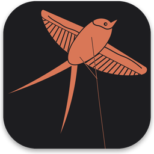

# Kiteline

### A remote for the coding agents already running on your computers.

Kiteline puts every Claude Code, Codex, OpenCode and DeepSeek Harness session on your computers (in VS Code, the terminal or over Remote-SSH) on your iPhone, iPad and Apple Watch. Keep using your agents exactly as you do now. When you step away, follow every step, approve requests, answer questions and send the next task from your phone.

<br>

[](https://tars.betac.cn)
[](https://tars.betac.cn/download/)
[](https://apps.apple.com/app/id6825244029)

[](LICENSE)
[](https://github.com/hon6/kiteline/releases)


**English** · [简体中文](README.zh-CN.md)

</div>

<br>

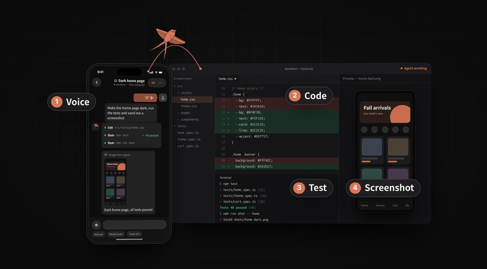

## Install

**On your computer** (Mac, Windows or Linux), one command:

```bash
# macOS and Linux
curl -fsSL https://tars.betac.cn/install.sh | sh
```

```powershell
# Windows (PowerShell)
irm https://tars.betac.cn/install.ps1 | iex
```

Or with a package manager: `brew install --cask hon6/kiteline/kiteline` on the Mac, or `scoop bucket add kiteline https://github.com/hon6/scoop-kiteline` then `scoop install kiteline` on Windows.

On a Linux server without a desktop, add `--service` to run it as a systemd user service: `curl -fsSL https://tars.betac.cn/install.sh | sh -s -- --service`. Prefer a regular installer? Download it from [tars.betac.cn](https://tars.betac.cn/en/) or [GitHub Releases](https://github.com/hon6/kiteline/releases). The script verifies each download against its published SHA-256 checksum.

**On your phone**, get Kiteline from the [App Store](https://apps.apple.com/app/id6825244029) (iPhone, iPad and Apple Watch) and scan the pairing code shown on your computer. No account to create.

**On Android, or without installing an app**, scan this code with WeChat to open the Kiteline Mini Program. Demo mode lets you try it right away; pair it with your computer the same way.

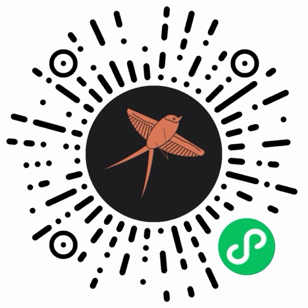

Your existing agent sessions show up on the phone right away. More in the [install guide](guide/user/install.md).

## "So what's the catch?"

- The desktop app is open source (AGPL-3.0) and free, with no limits.
- The phone app is free, every feature included, whenever your phone is on the same Wi-Fi as your computer.
- Only remote access, reaching your computer from another network, needs Kiteline Pro: about the price of a cup of bubble tea a month, which pays for the relay servers.
- No account, no API keys, and no changes to your agents' configuration.

## Why Kiteline

- **Nothing new to move into.** Your sessions stay in VS Code, the terminal or Remote-SSH, exactly where they are. The phone picks up the very same session; there is no second interface to start your work in.
- **Never touches your AI login.** Kiteline doesn't sign in to Claude or any other AI service, never reads API keys or tokens and never calls a model API. It reads the transcripts your agents already write and acts only through interfaces they offer.
- **Agents report back.** Built-in skills let agents send screenshots, walk through web features in a real browser with Playwright and send you the report, track what only you can do as to-dos, and show which stage they are at.
- **Approve from your wrist.** Commands, plans and questions reach the lock screen and Apple Watch; a Live Activity shows who is waiting and what step each session is on; risky commands always ask twice.
- **See the whole team at once.** World mode and the Flow Board show every session on every computer on one screen.

## See it in action

<table>
<tr>
<td width="50%"><a href="https://tars.betac.cn/assets/video/kiteline-1-en.mp4">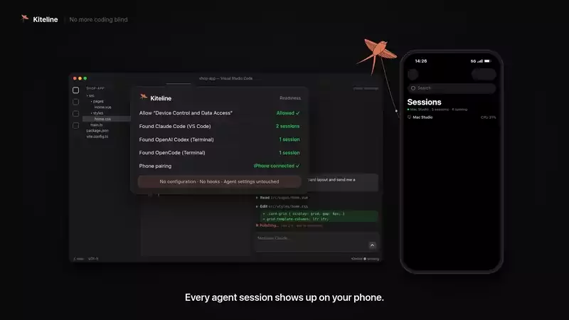</a><br><sub><b>No more coding blind.</b> Send a task by voice; the agent reports back with screenshots.</sub></td>
<td width="50%"><a href="https://tars.betac.cn/assets/video/kiteline-2-en.mp4">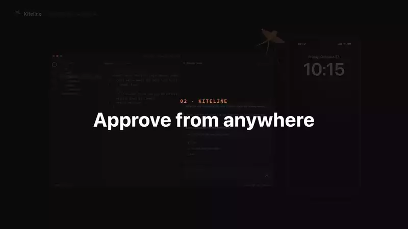</a><br><sub><b>Approve from anywhere.</b> Lock screen, phone or watch; risky commands always ask twice.</sub></td>
</tr>
<tr>
<td width="50%"><a href="https://tars.betac.cn/assets/video/kiteline-3-en.mp4">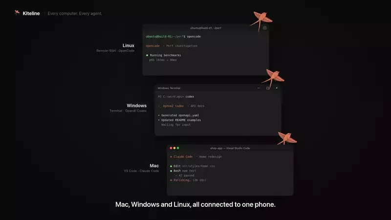</a><br><sub><b>Every computer, every agent.</b> Mac, Windows, Linux and Remote-SSH in one list.</sub></td>
<td width="50%"><a href="https://tars.betac.cn/assets/video/kiteline-4-en.mp4">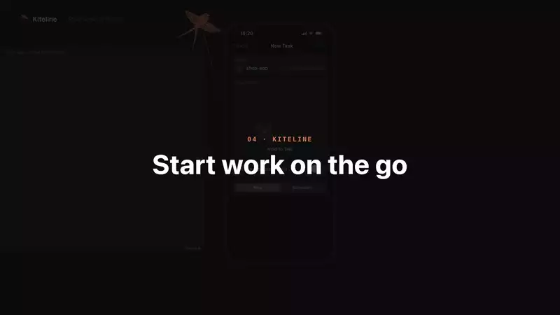</a><br><sub><b>Start work on the go.</b> Dispatch a task and check today's progress at a glance.</sub></td>
</tr>
</table>

<sub>Click any clip to watch the full video.</sub>

## Highlights

| | |
|---|---|
| **One list for every agent** | Claude Code (VS Code and terminal), Codex, OpenCode, DeepSeek Harness, Qwen Code, Kimi Code, CodeBuddy, ZCode, Antigravity, Grok Build and more. New agents ship as signed plugins, so supporting one doesn't need an app update. |
| **Approve anywhere** | Permission requests, plan approvals and multiple-choice questions become cards on the lock screen, the phone and the watch. |
| **Reply your way** | Type, hold to talk (on-device speech recognition), attach photos and screenshots, or start a new task in any project. |
| **See the work, not just the chat** | Live steps, commands, diffs, test output and images, plus a code editor with Git and a terminal that runs inside each session. |
| **Task progress** | Each session shows its current stage (for example "2/4 Developing"), and agents can send screenshots and reports straight to your phone. |
| **Goals** | Give a Claude Code or Codex session a goal (`/goal`) from your phone and the agent keeps working, round after round, until it is met. The session list shows which round it is on, the chat shows what the last check said is still missing, and you get a notification when the goal is met, can't be met or stops. |
| **To-dos** | Anything the agent needs *you* to do is picked up from the conversation and tracked until it's done. |
| **Group chats** | Sessions on different computers and projects coordinate with each other through Kiteline. |
| **World mode** | A voxel office where every session is a worker at a desk, so you can see the whole team at a glance. |
| **Flow Board** | Every session on one screen: what each one reads, what it does and where the output goes. Each tool call is a line, and a trail of light runs along it the moment the call happens. |
| **Live Activities** | While agents work or wait for you, the iPhone Lock Screen and Dynamic Island show every session’s status: waiting ones first, running ones with their current step, and All done when everything stops. Tap to jump into the session; your computer updates it through push, so the app does not need to be open. |
| **Web replies** | When a result is best shown as a chart, comparison table or flow diagram, the agent sends it as a web page; on the phone it opens in the app — zoom, interact, share — and cannot read any app data. |
| **Links** | Prompt links turn a task into a link: your teammate opens a New Task with the prompt and project filled in, and nothing runs until they confirm. Read-only sharing creates a local network address so anyone on the same Wi-Fi can follow the conversation and steps in a browser, served straight from your computer. |

## Supported agents

| Agent | What you can do from your phone |
|---|---|
| **Claude Code** | Full control: VS Code extension and CLI |
| **Codex** | Full control: CLI, VS Code extension and desktop app |
| **OpenCode** | Full control |
| **Cursor** | Plugin coming soon (source in [`plugins/cursor`](plugins/cursor)) |
| **Qwen Code** | Reply and approve when it runs in tmux; view-only otherwise |
| **DeepSeek Harness** | Full control (opt-in) |
| **Proma** | View only |
| **Kimi Code** · **Hermes** · **Grok Build** | Reply, approve, answer, interrupt and close when the CLI runs in tmux; view-only otherwise |
| **CodeBuddy Code** · **WorkBuddy** | CodeBuddy Code: full control in tmux. WorkBuddy desktop app: view only |
| **ZCode** | Send messages from your phone; that turn's approvals and questions come to your phone, and you can interrupt it |
| **Antigravity** | CLI in tmux: reply, approve, answer, interrupt, close. Desktop app and IDE: view only |
| **Muse Code** | In tmux: reply, interrupt, close (commands are confirmed on the computer) |
| **trae-agent** | View tasks and full records; send tasks when it runs in tmux |

The per-platform matrix is in **[PLUGINS.md](PLUGINS.md)**. It is generated from the capabilities each plugin declares and updated with every release.

**Why are some agents view-only?** Kiteline never touches your AI credentials and never modifies an agent. It only acts through interfaces the agent itself offers: its local server or IPC, extension points such as hooks or an editor URI, or the terminal (tmux) it runs in. When an agent offers none of these, Kiteline can still show its sessions and full transcripts from disk, but it won't simulate input or patch the agent to take control. The app tells you why a session is view-only and how to enable more, for example by starting the CLI in tmux. Details are in the [plugin guide](guide/plugin-development.md#why-some-agents-are-view-only).

**Build a plugin.** New agents are added as plugins: a manifest plus a small Python module running in the watcher. The [plugin development guide](guide/plugin-development.md) covers the manifest, the interface and the rules, and `tools/plugin_check.py` lets you test a plugin on your own machine. Open a pull request: we review and test it, then sign it and publish it to the official plugin index, and every Kiteline user gets it without an app update.

## FAQ

**Can this get my Claude or Codex account banned?**
Kiteline doesn't sign in to any AI service, doesn't use your subscription's tokens and never calls a model API, so it doesn't change how your agents talk to their providers. Your agents keep running on your computer under your own account, exactly as before. Kiteline reads the transcripts they write and types into the same session the way you would.

**Does my code go through your servers?**
On the same network, no: the phone talks to your computer directly over HTTPS, pinned to a certificate your computer issued at pairing. From another network Kiteline first tries a direct peer-to-peer connection and only falls back to the relay when that fails. Everything is end-to-end encrypted; the relay can't read it and doesn't store it. See [Remote access](guide/user/remote-access.md).

**Do I have to change how I work?**
No. Keep starting sessions in VS Code or the terminal. Kiteline finds them on its own. Terminal sessions that should accept replies from the phone need to run inside tmux.

**Is there an Android app?**
Use the Kiteline WeChat Mini Program: scan the [code under Install](#install) with WeChat. Native apps are available for iPhone, iPad and Apple Watch.

**Can I use it with agents on a server?**
Yes. Install Kiteline on the server with `--service`, or add the server as a Remote-SSH host in the desktop app and Kiteline deploys a small read-only watcher over SSH (Python 3.8+ standard library only).

**How is this different from Claude Code's Remote Control?**
Remote Control continues one Claude Code session in the Claude app. Kiteline shows every agent on every computer in one list, and adds lock-screen and Apple Watch approvals, screenshots and test reports from the agent, to-dos, goals, group chats between sessions, a code editor with Git and a terminal.

More answers in the [FAQ](guide/user/faq.md).

## Documentation

- [Install and first run](guide/user/install.md)
- [Supported agents and how each one connects](guide/user/agents.md)
- [Approvals, plans and questions](guide/user/approvals.md)
- [Remote access](guide/user/remote-access.md)
- [Privacy and security](guide/user/privacy.md)
- [FAQ](guide/user/faq.md)
- Building a plugin for another agent: [plugin development guide](guide/plugin-development.md)

## Architecture

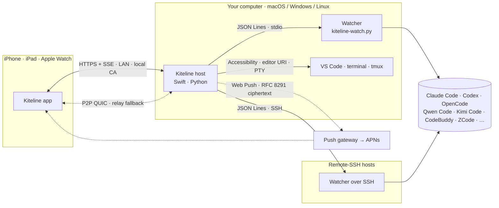

## Under the hood

- **Session discovery.** A single-file Python watcher (`watcher/kiteline-watch.py`) with **zero third-party dependencies** runs on the local machine and on any Remote-SSH host over plain SSH. It follows Claude Code's session registry and JSONL transcripts, talks to Codex and OpenCode through their own local server protocols, and lets plugins cover other agents, for example through hooks an agent provides. Everything is normalized into one JSON Lines event stream.
- **Input delivery.** Claude Code has no writable stdin, so Kiteline delivers input through the front end:
  - **VS Code sessions**: Kiteline finds the right window through the Accessibility API, opens the extension's own `vscode://anthropic.claude-code/open` URI to select the session and prefill the prompt, checks the input box and then submits.
  - **CLI sessions in tmux**: the watcher drives them directly.
  - **Other terminal sessions**: Kiteline walks the process tree to the terminal app that hosts the session.
  - **Codex and OpenCode**: replies, approvals and answers go over their native protocols.
- **Transport and pairing.** The phone talks to the host over HTTPS on the local network. Each computer has its own root CA, and X.509 name constraints limit it to private address ranges. Live state is streamed as Server-Sent Events, and the computer is found automatically via Bonjour / mDNS. Pairing uses a 6-digit code, or a QR code that carries a one-time token and the CA fingerprint.
- **End-to-end encrypted notifications.** Payloads are encrypted on the computer with Web Push (RFC 8291 `aes128gcm`, VAPID per RFC 8292). They are decrypted only on the device, by a notification service extension. The push gateway only ever relays ciphertext to APNs.
- **Remote access** (closed-source component). Built with Rust and [iroh](https://github.com/n0-computer/iroh): QUIC connections addressed by device public keys, NAT hole punching with relay fallback, and path migration between Wi-Fi and cellular without dropping the session. Only paired devices can connect.
- **Signed plugins.** Agents beyond the built-ins are distributed through an Ed25519-signed index. Each manifest declares capabilities (view, reply, approve, answer, interrupt, …) and the permissions it needs, and every client renders exactly what an agent supports.
- **On-device speech.** Hold-to-talk transcription runs locally with [sherpa-onnx](https://github.com/k2-fsa/sherpa-onnx) and the Fun-ASR-Nano model, so audio never leaves your own devices.
- **Live Activities.** The iPhone reports its ActivityKit push-to-start token and each activity’s update token to the computer. The computer starts one per round of work, coalesces updates (a new waiting session goes out at once, everything else at most every 8 seconds) and ends it after 90 idle seconds, sending through the push gateway to APNs’ `liveactivity` channel. Apple requires this content to be plaintext, so it carries only session titles and status.
- **Read-only sharing.** While something is shared, the computer opens a separate local-network HTTP port that serves only `/g/` (closed when nothing is shared). The page polls a snapshot every 8 seconds with an ETag; snapshots are built from the session record on demand, leave out reasoning, images and key info, and never pass through a server.
- **World mode.** A [three.js](https://threejs.org) scene shared by every platform and rendered from the same state stream.
- **Flow Board.** Also three.js, on the same host protocol. Cards are thin slabs with canvas textures; each line kind is one `LineSegments` buffer written as a ring, so the line count stays bounded. Base lines use normal blending so hundreds of them stay a faint grey, while only the lit lines (up to 320) and the particles (one shader-driven `Points`, up to 1,500) are additive. An automatic camera pans and zooms to the busiest card — straight on, in 2D — and lists the calls that just passed through it.

## Tech stack

| Component | Technology | Size |
|---|---|---|
| Mac host | Swift, SwiftUI, AppKit; [SwiftTerm](https://github.com/migueldeicaza/SwiftTerm) for terminals | ~26k lines |
| Shared UI (Mac and iPhone) | SwiftUI module `KitelineKit` | ~42k lines |
| Session watcher | Python 3, standard library only | ~13k lines |
| Windows and Linux host | Python 3.10+, cryptography, zeroconf, sherpa-onnx | ~17k lines |
| Windows and Linux window | C#, .NET 10, [Avalonia](https://avaloniaui.net) | ~34k lines |
| Code editor | [CodeMirror 6](https://codemirror.net) | |
| World mode and Flow Board | [three.js](https://threejs.org) | |
| Remote access *(not in this repo)* | Rust, iroh (QUIC) | |

## Screenshots

<table>
<tr>
<td>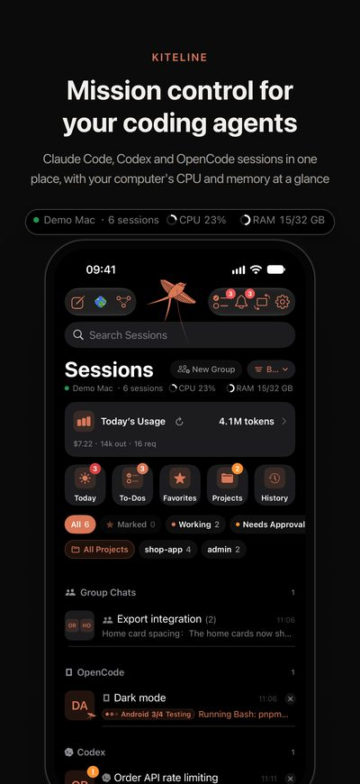</td>
<td>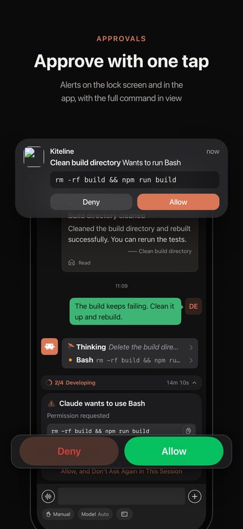</td>
<td>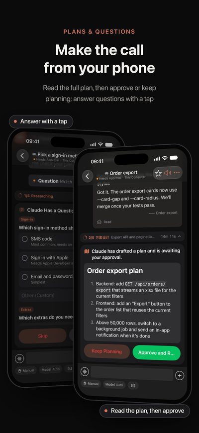</td>
<td>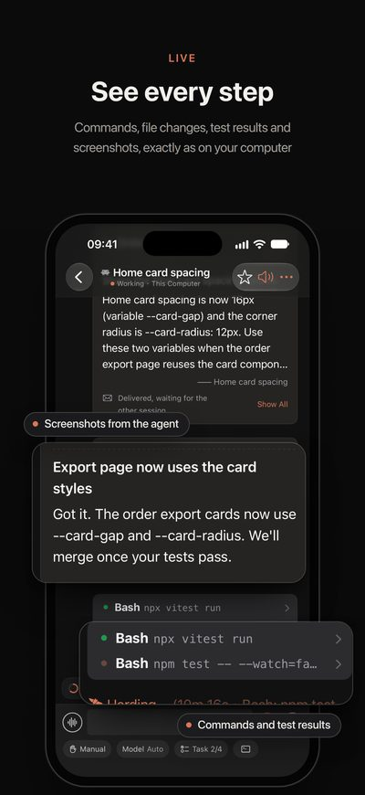</td>
<td>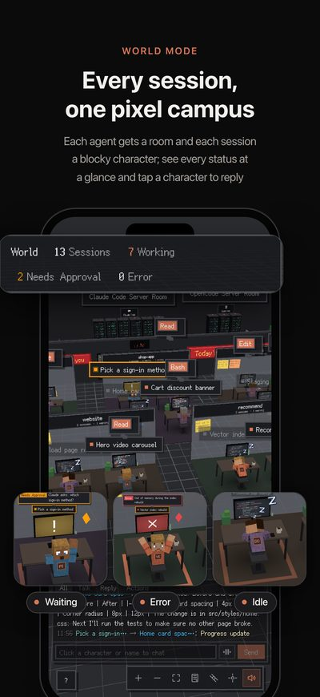</td>
</tr>
<tr>
<td>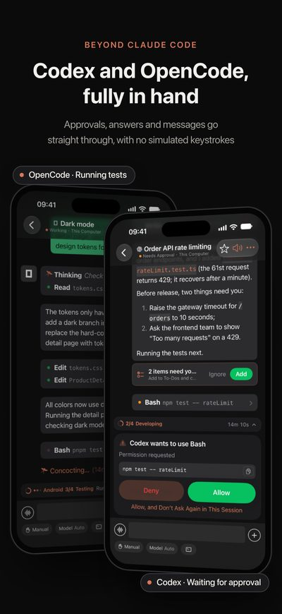</td>
<td>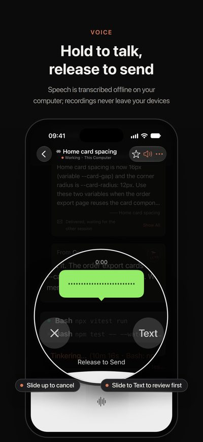</td>
<td>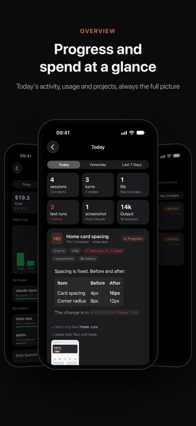</td>
<td>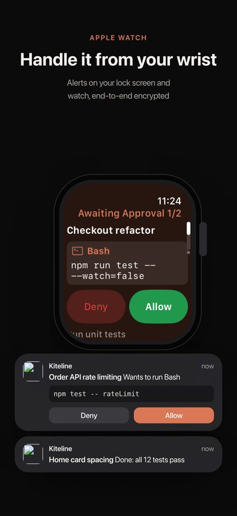</td>
<td>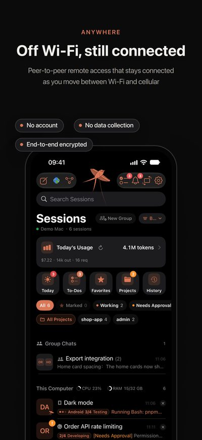</td>
</tr>
</table>

<table>
<tr>
<td width="25%">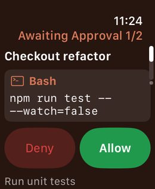</td>
<td width="25%">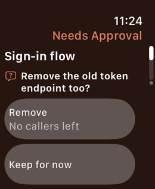</td>
<td width="25%">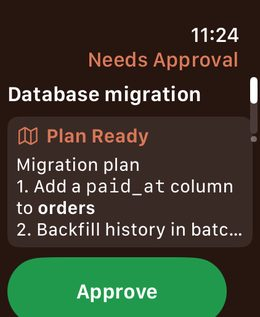</td>
<td width="25%">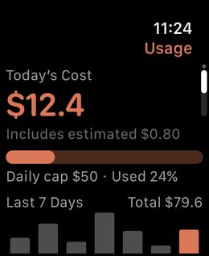</td>
</tr>
</table>

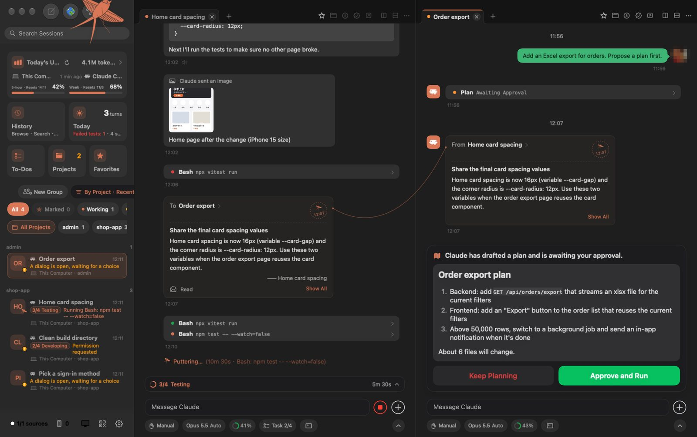

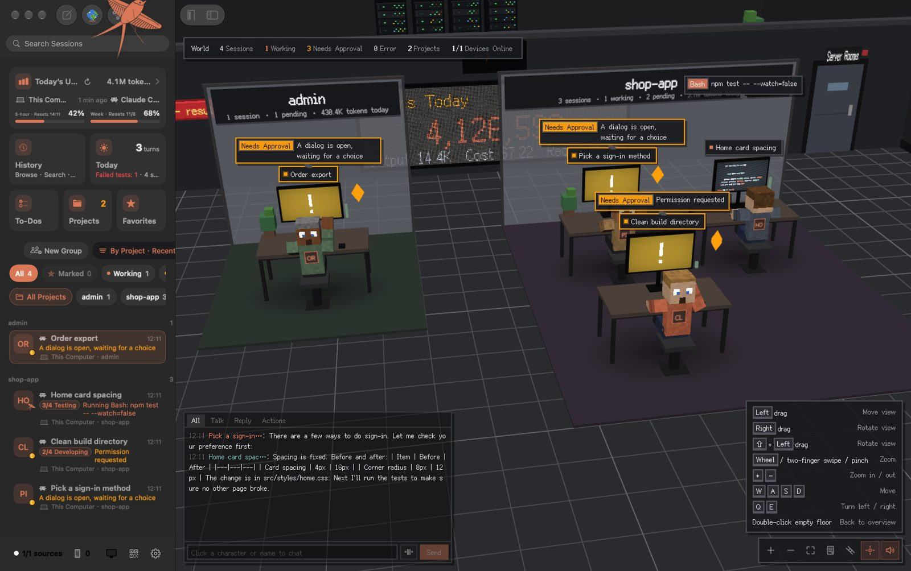

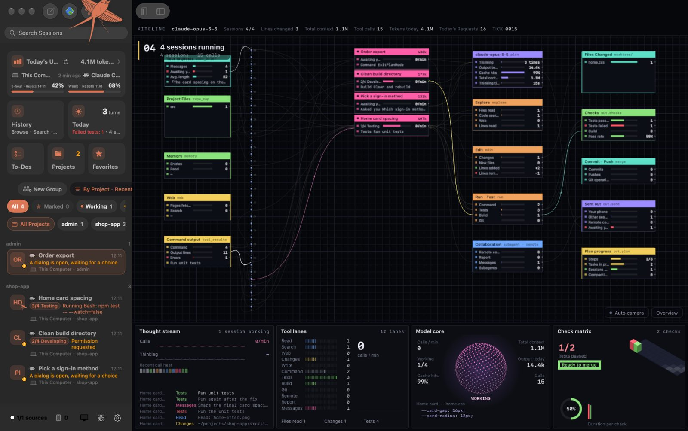

<table>
<tr>
<td width="62%">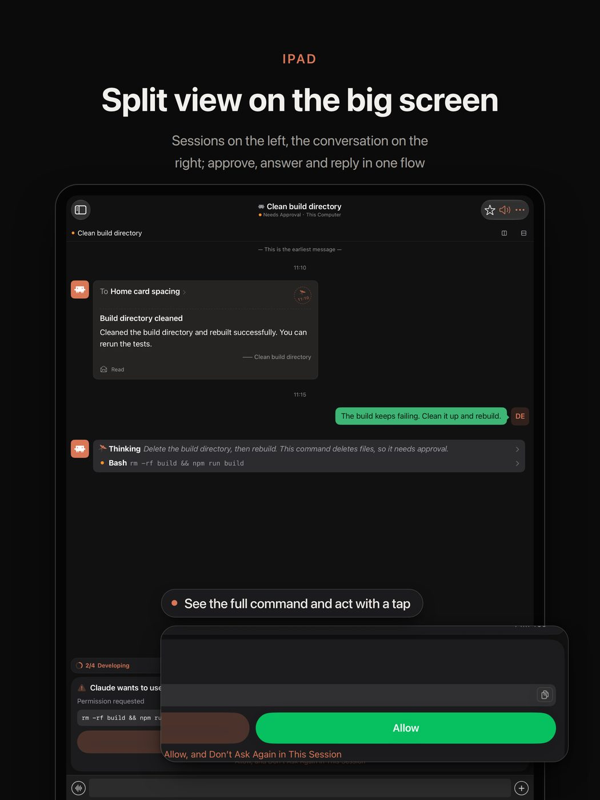</td>
<td width="38%">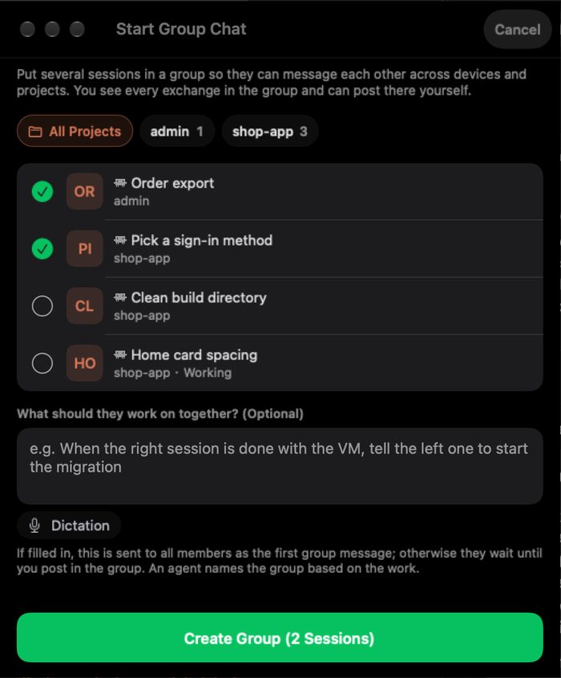</td>
</tr>
</table>

<sub>Every app is available in English and Simplified Chinese, and follows your system language by default.</sub>

## Open source and subscription

**Build it yourself.** All the source code is public in this repository. If you have the time and enjoy building things, you're welcome to build, modify and extend it under the terms of the AGPL-3.0. Suggestions are always welcome through Issues.

**Use the official build.** If you'd rather not spend time and tokens building and maintaining it yourself, download the official build from the [website](https://tars.betac.cn/download/):

- When your phone and computer are on the same Wi-Fi, every feature is free.
- To use Kiteline from any network, subscribe to Kiteline Pro in the iPhone app. It costs about as much as a cup of bubble tea a month and pays for server renewal and maintenance.

## Repository layout

```text
.
├── Sources/                Mac host (Swift, SwiftUI)
├── Resources/              Mac resources, world mode (three.js), code editor (CodeMirror)
├── KitelineKit/            SwiftUI components shared by the Mac and iPhone apps
├── watcher/
│   └── kiteline-watch.py   Session watcher, runs locally or over SSH (stdlib only)
├── desktop/
│   ├── kiteline/           Windows and Linux host (Python)
│   ├── client/             Windows and Linux native window (C#, Avalonia)
│   └── packaging/          PyInstaller and tarball packaging
├── plugins/                Agent plugins distributed separately from the app
├── PLUGINS.md              Supported agents per platform (generated)
├── tools/plugin_check.py   Test a plugin on your own machine
├── tests/                  Integration tests for the HTTP API and the watcher
├── build.sh · install.sh   Mac build and install
└── docs/                   Plugin development guide, agent integration notes, world mode
```

Not included: the remote access component, the iPhone, iPad and Apple Watch app shells (pairing, settings, widgets, Xcode project) and the servers (relay, push gateway, statistics). A build from this repository works on your local network. For remote access, use the official build; see [Open source and subscription](#open-source-and-subscription).

## Build from source

### Mac

Requirements:

- macOS 14 or later.
- Xcode, or just the Command Line Tools (`xcode-select --install`).
- Python 3, which the session watcher runs on.

```bash
git clone https://github.com/hon6/kiteline.git
cd kiteline
./install.sh                 # build, install to /Applications/Kiteline.app and launch
./install.sh my-server       # also watch sessions on Remote-SSH hosts (passwordless ssh)
./build.sh                   # build only → dist/Kiteline.app
```

A build from source replaces an installed official Kiteline and keeps its data and pairings. To make that possible, a few runtime identifiers keep the project's early names:

- the data folder `~/Library/Application Support/TARS`;
- the executable name;
- the watcher installed as `~/.ccpulse/ccpulse-watch.py` on each machine.

The app is signed with a self-signed identity created on the first build, so macOS permissions carry over between rebuilds.

Optional offline speech recognition: copy `libsherpa-onnx-c-api.dylib` and `libonnxruntime.dylib` from the `sherpa-onnx-core` 1.13.8 macOS arm64 wheel into `vendor/sherpa-onnx/lib/`. Without them, Kiteline falls back to the system speech recognizer.

### Windows and Linux

Requirements: Python 3.10 or later.

```bash
cd desktop
python3 -m venv .venv && . .venv/bin/activate      # Windows: .venv\Scripts\activate
pip install -r requirements.txt
python -m kiteline               # opens the console in your browser, adds a tray icon
python -m kiteline --headless    # servers without a desktop: prints the pairing code
```

Packages:

- Linux tarball: `bash desktop/packaging/build-linux.sh`.
- Windows zip: `desktop\packaging\build-windows.ps1`.
- Native window (.NET 10): run `bash desktop/client/publish.sh linux-x64 win-x64` first, then package with `KITELINE_WITH_CLIENT=1`.

### Pair your phone

1. Install Kiteline from the [App Store](https://apps.apple.com/app/id6825244029).
2. Open **Phone Access** on the computer: the menu bar icon on Mac, the tray or the console on Windows and Linux.
3. Scan the QR code. No account is needed.

## Privacy and security

- **No AI credentials.** Kiteline never signs in to Claude or any other AI service, never reads or forwards API keys or session tokens, never calls a model API and never modifies the agents themselves.
- **Your devices only.** Conversations and code travel only between your computer and your phone, end-to-end encrypted.
- **Usage statistics.** Every 15 minutes the computer sends a summary to the Kiteline server: device types and versions, which agents and models are used, token counts and the display name you set, with all IDs hashed. It never includes conversations, code, file names, paths or session titles. Turn it off in Settings → **Send usage statistics** (`Sources/UsageStats.swift`, `desktop/kiteline/stats.py`).
- **Read-aloud.** If you choose Microsoft voices for reading replies aloud (optional, via edge-tts), the text being read is sent to Microsoft to be synthesized.

## Contributing

Issues, discussions and pull requests are welcome, especially **plugins for new agents** (see the [plugin development guide](guide/plugin-development.md)). Before opening a pull request, please read [CONTRIBUTING.md](CONTRIBUTING.md).

## License

Copyright © 2026 hon6. Licensed under the [GNU Affero General Public License v3.0](LICENSE). If you distribute a modified version, or run one as a network service for others, you must make your source code available under the same license. For other licensing arrangements, contact hon6@foxmail.com.

"Kiteline" and the paper-kite logo identify the official app; please don't use them for modified versions. Agent names and logos (from [LobeHub Icons](https://github.com/lobehub/lobe-icons), MIT) belong to their respective owners and are used only to show which tool a session comes from. Kiteline is not affiliated with or endorsed by Anthropic, OpenAI, Anysphere or any other agent vendor. Third-party licenses are listed in `Resources/ThirdPartyNotices.json`.

<div align="center"><br><a href="https://tars.betac.cn"><b>tars.betac.cn</b></a></div>
