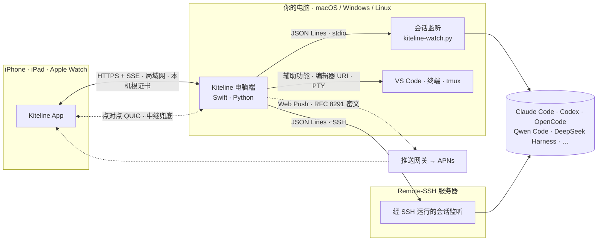

<div align="center">


# Kiteline

### 人离开电脑，编程 Agent 照样往下干。

Kiteline 把你各台电脑上的 Claude Code、Codex、OpenCode、DeepSeek Harness 会话同步到 iPhone、iPad 和 Apple Watch：看每个 Agent 在做什么，批准它的请求，回答它的提问，派下一件活。

<br>

[](https://tars.betac.cn)
[](https://tars.betac.cn/download/)
[](https://apps.apple.com/app/id6825244029)

[](LICENSE)
[](https://github.com/hon6/kiteline/releases)


[English](README.md) · **简体中文**

</div>

<br>


> **官方网站：[tars.betac.cn](https://tars.betac.cn)**。Mac、Windows、Linux 正式版可在官网或 [GitHub Releases](https://github.com/hon6/kiteline/releases) 下载；iPhone、iPad、Apple Watch App 请到 [App Store](https://apps.apple.com/app/id6825244029) 下载。

## 演示

<table>
<tr>
<td width="50%"><a href="https://tars.betac.cn/assets/video/intro-zh.mp4#t=64"></a><br><sub><b>语音派活</b>：手机上说一句，电脑上的 Agent 立刻开工。</sub></td>
<td width="50%"><a href="https://tars.betac.cn/assets/video/intro-zh.mp4#t=150"></a><br><sub><b>随时确认</b>：允许、拒绝、回答提问、批准计划，轻点即可。</sub></td>
</tr>
<tr>
<td width="50%"><a href="https://tars.betac.cn/assets/video/intro-zh.mp4#t=120"></a><br><sub><b>多 Agent</b>：插件市场装一个就行，不用等 App 更新。</sub></td>
<td width="50%"><a href="https://tars.betac.cn/assets/video/intro-zh.mp4#t=206"></a><br><sub><b>世界模式</b>：每台电脑一间机房，每个会话一个工位。</sub></td>
</tr>
</table>

<sub>点击任意片段观看完整介绍视频。</sub>

## 核心能力

| | |
|---|---|
| **所有 Agent 一个列表** | Claude Code（VS Code 与终端）、Codex、OpenCode、DeepSeek Harness、Qwen Code 等；新的 Agent 以签名插件下发，无需等待 App 更新。 |
| **随时随地确认** | 权限请求、计划审批、选择题都以卡片形式出现在锁屏、手机和手表上。 |
| **多种回复方式** | 打字、按住说话（本机离线识别）、附照片或截图，也能在任一项目中新建任务。 |
| **看到工作本身** | 实时步骤、命令、代码改动、测试输出与图片；内置带 Git 的代码编辑器，以及跑在会话里的终端。 |
| **任务进度** | 每个会话显示当前阶段（如「2/4 开发中」），Agent 可直接把截图和报告发到手机。 |
| **目标** | 在手机上给 Claude Code 或 Codex 会话设一个目标（`/goal`），Agent 一轮轮做下去，达成才停。会话列表显示第几轮，对话页显示最近一次检查说还差什么，达成、做不到或中途停下时推送提醒。 |
| **待办** | Agent 需要*你*亲自处理的事项从对话中自动识别并持续跟踪，直到完成。 |
| **会话群** | 不同电脑、不同项目的会话经 Kiteline 互相协作。 |
| **世界模式** | 像素风办公室，每个会话是工位上的一个小人，整个团队一眼看全。 |
| **数据流大屏** | 所有会话一块屏：每个会话读了什么、做了什么、产出去了哪。每次工具调用是一根线，调用发生时一串光点沿线流过。 |

## 支持的 Agent

| Agent | 在手机上能做什么 |
|---|---|
| **Claude Code** | 完整操作：VS Code 扩展与命令行 |
| **Codex** | 完整操作：命令行、VS Code 扩展、桌面版 |
| **OpenCode** | 完整操作 |
| **Cursor** | 插件即将上线（源码在 [`plugins/cursor`](plugins/cursor)） |
| **Qwen Code** | 在 tmux 中运行时可回复、确认；其他情况只读 |
| **DeepSeek Harness** | 完整操作（需手动开启） |
| **Proma** | 只读 |

各平台、各形态的详细情况见 **[插件清单](PLUGINS.zh-CN.md)**，它按各插件声明的能力自动生成，随每次发版更新。

**为什么有的 Agent 只能查看？** Kiteline 不碰你的 AI 凭证，也不修改任何 Agent，只通过 Agent 自己提供的途径操作：它的本机服务或 IPC 接口、hooks 或编辑器 URI 这类扩展点，或者它所在的终端（tmux）。一个 Agent 如果这些都没有提供，Kiteline 仍能从磁盘读取并显示它的会话和完整对话，但不会为了操作它而模拟输入或改动 Agent 本身。App 会说明某个会话为什么只读、怎样才能操作（例如把命令行放进 tmux 里运行）。详见[插件开发指南](docs/plugin-development.zh-CN.md#为什么有的-agent-只能查看)。

**开发插件**：新的 Agent 以插件形式接入，一个插件由一份清单加一个在会话监听里运行的 Python 小模块组成。[插件开发指南](docs/plugin-development.zh-CN.md)介绍了清单、接口和必须遵守的规则，用 `tools/plugin_check.py` 可以在本机测试插件。欢迎提交 Pull Request：我们审核、实测后签名，发布到官方插件索引，所有 Kiteline 用户无需更新 App 即可使用。

## 架构



## 技术实现

- **会话发现**：会话监听是一个单文件 Python 脚本（`watcher/kiteline-watch.py`），**不依赖任何第三方库**，在本机和任意 Remote-SSH 主机上经普通 SSH 运行。它跟踪 Claude Code 的会话注册表与 JSONL 对话记录，通过 Codex、OpenCode 各自的本机服务协议与其通信，其他 Agent 由插件接入（比如借助 Agent 提供的 hooks），最终统一成一条 JSON Lines 事件流。
- **输入投递**：Claude Code 没有可写的 stdin，Kiteline 从前端送入：
  - **VS Code 里的会话**：用辅助功能 API 找到对应窗口，调用扩展自带的 `vscode://anthropic.claude-code/open` URI 切换会话并预填内容，核对输入框后提交。
  - **tmux 里的命令行会话**：由会话监听直接投递。
  - **其他终端会话**：沿进程树找到所在的终端 App 再送入。
  - **Codex、OpenCode**：回复、确认、回答提问都走它们的原生协议。
- **传输与配对**：手机与电脑在局域网内走 HTTPS。每台电脑生成自己的根证书，并用 X.509 名称约束限定在私有地址段内。实时状态以 Server-Sent Events 推送，电脑经 Bonjour / mDNS 自动发现。配对使用 6 位验证码，或扫描带一次性令牌和根证书指纹的二维码。
- **端到端加密推送**：通知内容在电脑上按 Web Push（RFC 8291 `aes128gcm`、RFC 8292 VAPID）加密，只在设备上由通知服务扩展解密；推送网关转给 APNs 的始终是密文。
- **远程访问**（闭源组件）：基于 Rust 与 [iroh](https://github.com/n0-computer/iroh)。连接以设备公钥寻址，走 QUIC，能打洞直连就直连、打不通走中继兜底；在 Wi-Fi 与蜂窝网络之间切换时连接不中断。只允许已配对的设备连入。
- **签名插件**：内置之外的 Agent 通过 Ed25519 签名的插件索引下发。插件清单声明能力（查看、回复、确认、回答、中断……）与所需权限，各端按 Agent 实际支持的能力渲染界面。
- **本机语音识别**：按住说话由 [sherpa-onnx](https://github.com/k2-fsa/sherpa-onnx) 与 Fun-ASR-Nano 模型在本机完成，音频不离开你自己的设备。
- **世界模式**：[three.js](https://threejs.org) 场景各端共用一份，由同一条状态流驱动。
- **数据流大屏**：同样是 three.js，和世界模式共用宿主协议。卡片是贴 Canvas 纹理的薄板；每种线是一个环形写入的 `LineSegments`，线的数量有上限。底层的线用普通叠加，几百根叠起来也只是一层淡灰；只有亮起的线（最多 320 根）和光点（一个着色器驱动的 `Points`，最多 1500 颗）用加法混合。自动运镜正对平面，平移、放大到最忙的卡片，列出刚经过它的几次调用。

## 技术栈

| 组件 | 技术 | 规模 |
|---|---|---|
| Mac 电脑端 | Swift、SwiftUI、AppKit；终端用 [SwiftTerm](https://github.com/migueldeicaza/SwiftTerm) | 约 2.6 万行 |
| 共用界面（Mac 与 iPhone） | SwiftUI 模块 `KitelineKit` | 约 4.2 万行 |
| 会话监听 | Python 3，仅标准库 | 约 1.3 万行 |
| Windows、Linux 电脑端 | Python 3.10+、cryptography、zeroconf、sherpa-onnx | 约 1.7 万行 |
| Windows、Linux 窗口 | C#、.NET 10、[Avalonia](https://avaloniaui.net) | 约 3.4 万行 |
| 代码编辑器 | [CodeMirror 6](https://codemirror.net) | |
| 世界模式、数据流大屏 | [three.js](https://threejs.org) | |
| 远程访问（*不在本仓库*） | Rust、iroh（QUIC） | |

## 截图

<table>
<tr>
<td></td>
<td></td>
<td></td>
<td></td>
<td></td>
</tr>
<tr>
<td></td>
<td></td>
<td></td>
<td></td>
<td></td>
</tr>
</table>

<table>
<tr>
<td width="25%"></td>
<td width="25%"></td>
<td width="25%"></td>
<td width="25%"></td>
</tr>
</table>


<table>
<tr>
<td width="62%"></td>
<td width="38%"></td>
</tr>
</table>

## 关于开源与订阅

Kiteline 的初衷是解放程序员，让编程 Agent 不再因为人不在电脑前而停滞。它最初是我们团队内部的日常工具，在真实的开发工作中不断打磨完善；如今开放出来，希望能帮助到更多开发者。

市面上的远程控制工具种类繁多。Kiteline 的每一项功能都源自真实的开发需求：多 Agent 管理、待办识别、会话群协作、代码编辑、会话终端、世界模式等，覆盖用 Agent 远程编程的完整流程，力求全面而实用。

**自行构建**：全部源码均在本仓库公开。如果您有时间、乐于动手，欢迎在遵守 AGPL-3.0 许可证的前提下自行构建、修改和二次开发，也欢迎通过 Issue 提出建议。

**直接使用**：如果您不希望在构建和维护上投入时间与 token，请直接从[官网](https://tars.betac.cn/download/)下载正式版：

- 手机与电脑连接同一 Wi-Fi 时，全部功能免费使用；
- 如需在任何网络环境下使用，可在 iPhone App 中订阅 Kiteline Pro。订阅费用约为每月一杯奶茶的价格，用于服务器续费与日常维护。

## 目录结构

```text
.
├── Sources/                Mac 电脑端（Swift、SwiftUI）
├── Resources/              Mac 资源、世界模式（three.js）、代码编辑器（CodeMirror）
├── KitelineKit/            Mac 与 iPhone 共用的 SwiftUI 组件
├── watcher/
│   └── kiteline-watch.py   会话监听，本机或经 SSH 运行（仅标准库）
├── desktop/
│   ├── kiteline/           Windows、Linux 电脑端（Python）
│   ├── client/             Windows、Linux 原生窗口（C#、Avalonia）
│   └── packaging/          PyInstaller 与 tar.gz 打包
├── plugins/                单独下发的 Agent 插件
├── PLUGINS.zh-CN.md        各 Agent 在各平台的支持情况（自动生成）
├── tools/plugin_check.py   在本机测试插件
├── tests/                  HTTP 接口与会话监听的集成测试
├── build.sh · install.sh   Mac 构建与安装
└── docs/                   插件开发指南、Agent 对接说明、世界模式
```

不在本仓库的部分：远程访问组件、iPhone / iPad / Apple Watch App 外壳（配对、设置、小组件、Xcode 工程），以及服务器（中继、推送网关、统计）。用本仓库编出的版本可在局域网内使用；远程访问请使用正式版，见[关于开源与订阅](#关于开源与订阅)。

## 从源码构建

### Mac

需要：

- macOS 14 或更新。
- Xcode，或者只装命令行工具（`xcode-select --install`）。
- Python 3（会话监听用）。

```bash
git clone https://github.com/hon6/kiteline.git
cd kiteline
./install.sh                 # 构建，装到 /Applications/Kiteline.app 并启动
./install.sh my-server       # 同时监听这些 Remote-SSH 主机（需免密 ssh）
./build.sh                   # 只构建 → dist/Kiteline.app
```

从源码编的版本会替换已装的正式版 Kiteline，数据和配对都保留。为此，少数运行时标识沿用项目早期的名字：

- 数据目录 `~/Library/Application Support/TARS`；
- 可执行文件名；
- 装到各台电脑上的 `~/.ccpulse/ccpulse-watch.py`。

第一次构建时会生成一个本机自签的签名身份，之后重编，系统权限都会保留。

本机离线语音识别（可选）：从 `sherpa-onnx-core` 1.13.8 的 macOS arm64 wheel 里取出 `libsherpa-onnx-c-api.dylib` 和 `libonnxruntime.dylib`，放进 `vendor/sherpa-onnx/lib/`。没有这两个文件时，会改用系统语音识别。

### Windows、Linux

需要 Python 3.10 或更新。

```bash
cd desktop
python3 -m venv .venv && . .venv/bin/activate      # Windows：.venv\Scripts\activate
pip install -r requirements.txt
python -m kiteline               # 在浏览器里打开控制台，挂托盘图标
python -m kiteline --headless    # 没有图形界面的服务器：配对码打印在终端里
```

打包：

- Linux 安装包：`bash desktop/packaging/build-linux.sh`。
- Windows 安装包：`desktop\packaging\build-windows.ps1`。
- 原生窗口（.NET 10）：先运行 `bash desktop/client/publish.sh linux-x64 win-x64`，再带 `KITELINE_WITH_CLIENT=1` 打包。

### 配对手机

1. 从 [App Store](https://apps.apple.com/app/id6825244029) 安装 Kiteline。
2. 在电脑上打开「手机访问」：Mac 在菜单栏图标里，Windows、Linux 在托盘或控制台里。
3. 用手机扫码，不需要注册账号。

## 隐私与安全

- **不碰 AI 凭证**：Kiteline 不登录 Claude 或任何 AI 服务，不读取、不转发 API Key 和会话令牌，不调用模型接口，也不修改 Agent 本身。
- **只在你自己的设备之间**：对话和代码只在你的电脑和手机之间加密传输。
- **使用统计**：电脑每 15 分钟向 Kiteline 服务器报一次精简数据，内容是设备类型和版本、用了哪些 Agent 和模型、token 数，以及你设置的显示名称；各种编号都做了哈希。不含对话、代码、文件名、路径和会话标题。可在设置里关闭「发送使用统计」（见 `Sources/UsageStats.swift`、`desktop/kiteline/stats.py`）。
- **朗读**：如果选用微软语音朗读回复（可选，经 edge-tts），要朗读的文字会发到微软服务器合成。

## 参与贡献

欢迎提 Issue、参与讨论、提交 Pull Request，尤其欢迎**为新的 Agent 开发插件**（见[插件开发指南](docs/plugin-development.zh-CN.md)）。提 Pull Request 前请先阅读 [CONTRIBUTING.md](CONTRIBUTING.md)。

## 许可

Copyright © 2026 hon6。以 [GNU Affero 通用公共许可证 v3.0](LICENSE)（AGPL-3.0）发布：分发修改后的版本，或者把修改后的版本作为网络服务提供给他人使用，都必须按同样的许可公开源代码。需要其他授权方式，请联系 hon6@foxmail.com。

「Kiteline」名称和纸鸢标志代表官方 App，修改后的版本请勿使用。各 Agent 的名称和标志（取自 [LobeHub Icons](https://github.com/lobehub/lobe-icons)，MIT）归各自所有者，只用来标明会话来自哪个工具。Kiteline 与 Anthropic、OpenAI、Anysphere 及其他 Agent 厂商没有隶属或背书关系。第三方许可见 `Resources/ThirdPartyNotices.json`。

<div align="center"><br><a href="https://tars.betac.cn"><b>tars.betac.cn</b></a></div>
